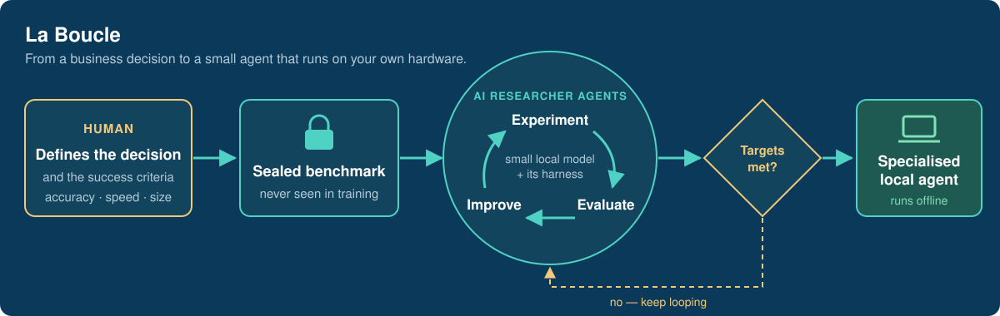
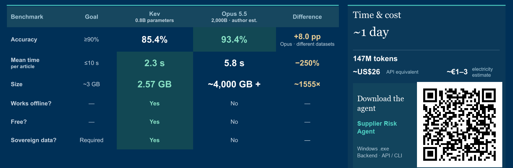
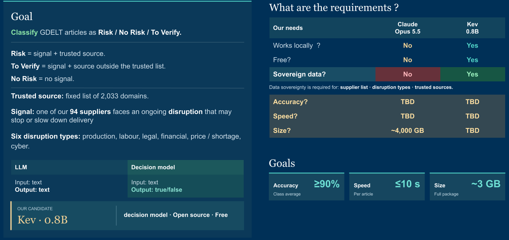
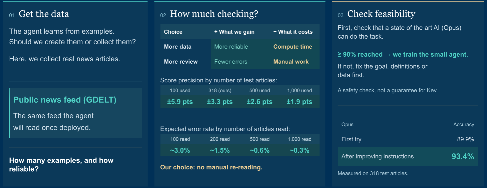
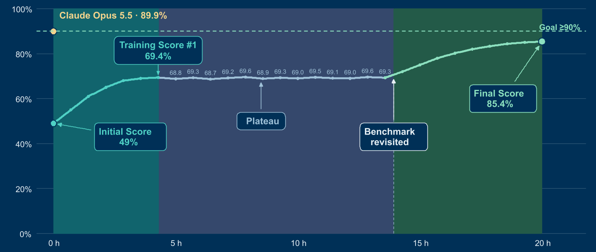

# La Boucle

**An autonomous training environment for decision models: AI agents turn a precisely defined business decision into a small, specialised agent that runs on your own hardware.**

## Why

General-purpose models are good at almost everything, and they are priced, sized and hosted to match. Most business decisions need one narrow call made reliably, often on data that cannot leave the building. La Boucle automates the research needed to build that agent, while a human keeps control of the goal, the success criteria and the final sign-off.

## The result that matters

**A 0.8-billion-parameter agent, trained autonomously in about a day, came within a few points of a frontier model on a specific business decision. It is about 1,500× smaller, 2.5× faster and runs offline on a laptop.**

The two accuracy scores come from different test sets, and the 90 % target has not been reached yet. The frontier model's size is an estimate.

### Try the agent

**[Download the Supplier Risk Agent](https://drive.google.com/drive/folders/1MrujvzAUr4UVTZc04md_izqEztCpwtIM)** (or scan the QR code above): a Windows desktop app that reads the news and flags supplier risks, and a Linux backend with a local API and CLI. The model and its runtime are included; nothing runs in the cloud. Setup instructions are in the folder's README.

## A worked case: supplier risk from the news

Presented to the supply-chain leadership of a Fortune 50 technology company as part of a Georgia Tech executive briefing programme.

**1. Define the goal precisely.** The decision, its three possible outputs, the requirements (local, free, sovereign data) and the targets for accuracy, speed and size.

**2. Decide how to train and check.** Where the examples come from, how many test cases make a score meaningful, and a feasibility check: a frontier model must first prove the task is learnable as defined.

**3. Let the agents train.** Researcher agents iterate on their own. When progress stalled on a plateau, revisiting the benchmark definition unlocked the next gain.

Illustrative view of the training run, as presented to the programme.

## Design principles

| | |
|---|---|
| **Sealed benchmark** | The agents that train a candidate never see the data that judges it. |
| **Gates, not self-report** | A candidate moves forward because a measurement says so, never because an agent claims it is done. |
| **Feasibility first** | Train a small model only once a large one has shown the task is learnable as defined. |
| **One model, many harnesses** | The same base model can be fitted with different harnesses for different decisions (being tested). |
| **Honest limits** | Agree on an acceptable error rate, then balance quality against training time. |

## Status

Active R&D prototype, run end to end on several cases. It is being generalised so that a new use case can start from a conversation rather than from code.

## Why the source is not here

La Boucle is a personal research system, and the method is the product. Happy to walk through it in detail, including a live demonstration, with anyone evaluating a collaboration.

---

**Anthony Hunt** — applied agentic AI: evaluating, training and deploying specialised agents.
[GitHub profile](https://github.com/anthohunt) · [anthony.hunt@yahoo.fr](mailto:anthony.hunt@yahoo.fr)
